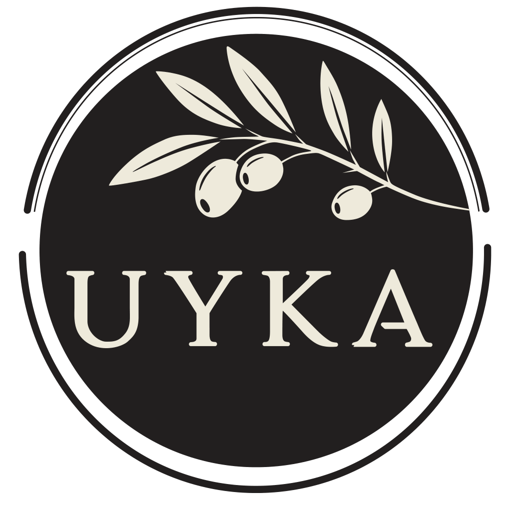

<p align="center">
  
</p>

<h1 align="center">UYKA · Corporate Website</h1>

<p align="center">
  Corporate website for <strong>UYKA</strong>, a third-generation olive oil producer from İznik, Bursa (since 1950).<br/>
  Built with Next.js as a fully static site: fast, secure and deployable to any web host.
</p>

<p align="center">
  
  
  
  
  
</p>

---

## Overview

The site presents UYKA's story, production process, quality analyses and product range, and gives retail and B2B buyers a direct way to request a quote. It replaces a legacy single-page site with a structured, content-driven build that is ready for additional languages.

| | |
|---|---|
| **Client** | UYKA (Öz Uygun Kardeşler Tarım San. ve Tic. Ltd. Şti.), İznik / Bursa |
| **Scope** | Information architecture, design, front-end development, brand asset pipeline, hosting setup |
| **Audience** | Retail customers, B2B buyers (HoReCa, distributors, private label) |
| **Language** | Turkish (English prepared in the i18n layer) |

## Highlights

- **Static export.** The whole site is prebuilt into `out/` and served as plain files. No Node.js server, minimal attack surface and low hosting cost.
- **Interactive 3D bottle.** Product pages render the bottle in 3D (React Three Fiber) using the real label artwork as a texture.
- **Quote and newsletter forms.** Submitted to a small, dependency-free PHP endpoint over authenticated SMTP. On static-only hosts, forms fall back to WhatsApp or e-mail.
- **Built-in image pipeline.** Source photos are converted at build time into responsive AVIF and WebP sizes, and favicons and the social share card are generated from the brand assets.
- **SEO.** Structured data (JSON-LD), per-page metadata, `sitemap.xml`, `robots.txt` and canonical `www` redirects.
- **Accessibility.** Accessibility panel, reading guide, reduced-motion support and keyboard navigation.
- **Privacy-friendly analytics.** Cookieless analytics (Plausible) behind a single `track()` facade.
- **Security headers.** HSTS, `X-Frame-Options`, `nosniff`, `Referrer-Policy` and `Permissions-Policy`, defined for both Vercel and Apache hosting.
- **i18n-ready.** Turkish lives at the root URL. English can be enabled by adding content and route files, without restructuring the site.

## Site map

| Page | Route |
|---|---|
| Home | `/` |
| Our Story | `/hikayemiz` |
| Production | `/uretim` |
| Quality and Analyses | `/kalite` |
| Products · Product detail | `/urunler` · `/urunler/[slug]` |
| B2B / Wholesale | `/b2b` |
| Journal · Article | `/gunluk` · `/gunluk/[slug]` |
| Contact | `/iletisim` |
| Privacy (KVKK) · Cookie Policy | `/kvkk` · `/cerez-politikasi` |

## Tech stack

| Layer | Technology |
|---|---|
| Framework | Next.js 16 (App Router, `output: "export"`) |
| UI | React 19, TypeScript 5, Tailwind CSS 4 |
| 3D | three.js, @react-three/fiber |
| Images | sharp (build-time AVIF / WebP generation) |
| Forms | PHP 7.4+ endpoint with SMTP (no dependencies) |
| Analytics | Plausible (cookieless) |
| Hosting | Any static host: Vercel, Netlify, Cloudflare Pages, or Apache / cPanel / Plesk |

## Getting started

**Requirements:** Node.js 20 or later.

```bash
npm install
npm run dev
```

Open [http://localhost:3000](http://localhost:3000).

### Scripts

| Command | Purpose |
|---|---|
| `npm run dev` | Start the development server |
| `npm run build` | Build the static site into `out/` |
| `npm run lint` | Run ESLint |
| `npm run typecheck` | Type-check with TypeScript |
| `npm run assets` | Regenerate responsive images, logos, favicons and the share card |
| `npm run labels` | Generate representative labels for products not yet photographed |
| `npm run cutout` | Produce bottle packshots and 3D label textures |

## Project structure

```
src/
  app/          Routes (Turkish at the root), sitemap, robots, 404
  views/        Page-level compositions
  components/   UI, layout, sections, product, forms, motion, SEO
  content/      Company facts and page copy (per locale in content/<locale>/)
  i18n/         Locale configuration and route mapping
  lib/          SEO, forms, analytics, accessibility and formatting helpers
assets/         Source brand files, labels and photography
scripts/        Image and label generation
public/         Generated images, 3D textures, .htaccess, form endpoint
```

Content is kept separate from layout. Company details live in `src/content/company.ts` and page copy in `src/content/tr/`, so text can be updated without touching components.

## Deployment

1. Build the site. To enable the forms, set the endpoint during the build:
   ```bash
   NEXT_PUBLIC_FORM_ENDPOINT=/api/form.php npm run build
   ```
2. Upload the contents of `out/` to the web root (for example `httpdocs/` on Plesk). The form endpoint `api/form.php` is included.
3. Copy `uyka-form-config.php` **one level above the web root**, outside `httpdocs/`, and fill in the SMTP password there.

Security headers and the `www` redirect are configured in `public/.htaccess` for Apache and in `vercel.json` for Vercel.

> **Note:** The SMTP password in `uyka-form-config.php` is intentionally left empty. Never commit real credentials.

## Status

Product photography is in progress. Products that have not been photographed yet use **representative** packshots generated from the real bottle and label style. They will be replaced as new photos arrive.

## Rights

© UYKA. All rights reserved. The UYKA name, logo, label designs, product photography and copy belong to UYKA and may not be reused without permission.
